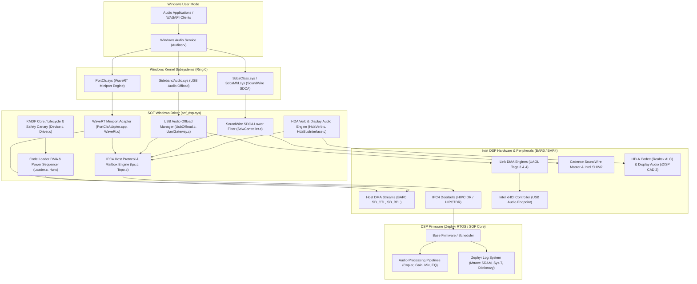
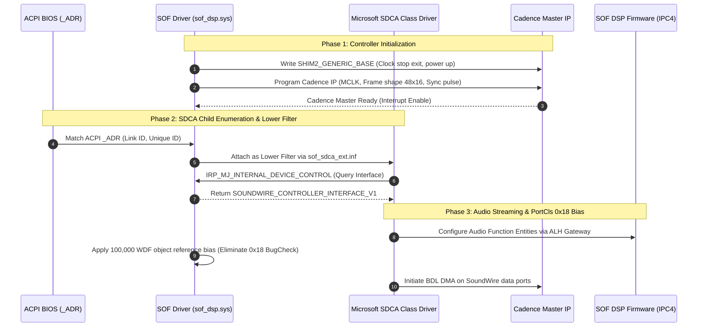
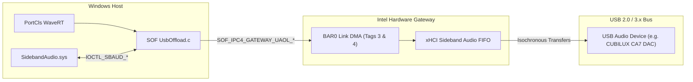
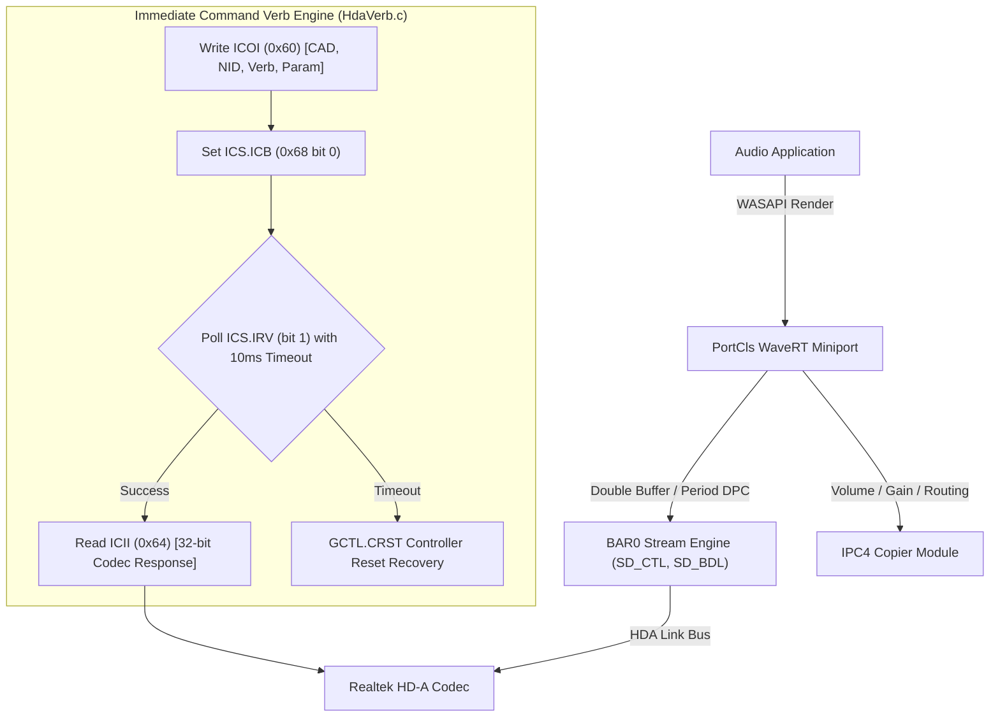
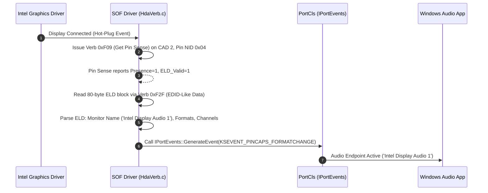
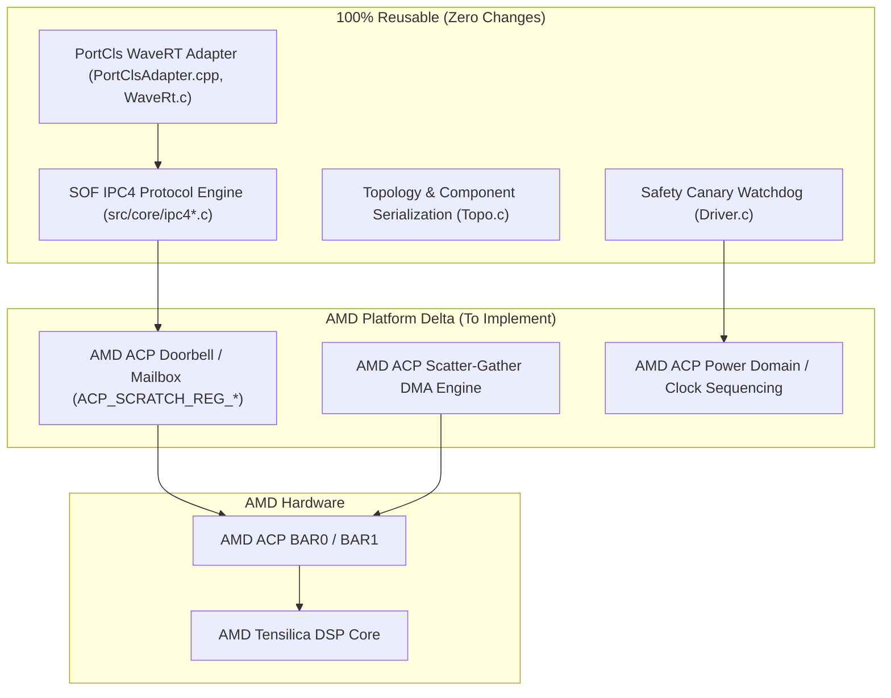
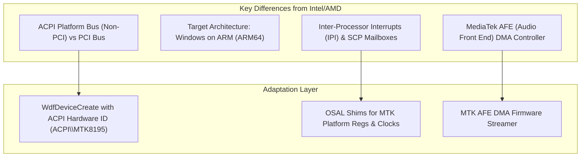
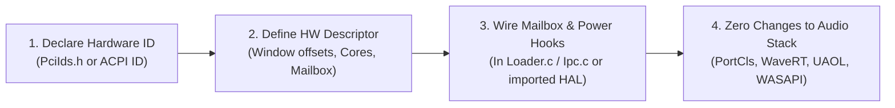
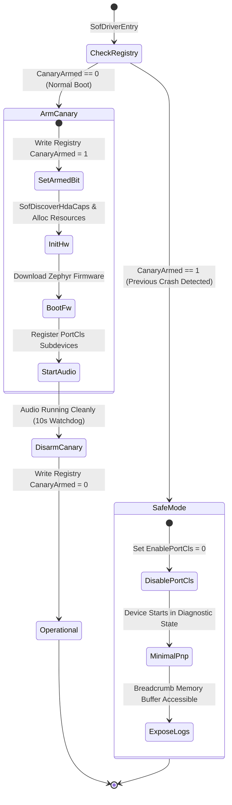
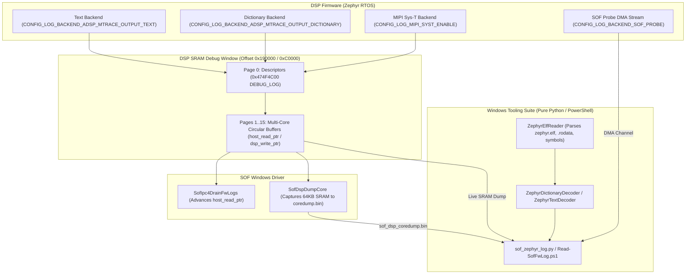

# Sound Open Firmware (SOF) Windows Audio Driver

[](./LICENSE)
[](https://learn.microsoft.com/en-us/windows-hardware/drivers/)
[](https://learn.microsoft.com/en-us/windows-hardware/drivers/download-the-wdk)

> [!NOTE]
> **Project Status: Work in Progress**  
> This driver is an active work in progress. While core streaming pipelines and hardware validation test suites are functional on target platforms, APIs, driver extensions, and platform features continue to undergo active development. In particular, **SoundWire integration with the Microsoft SDCA class driver (`SdcaClass.sys` / `SdcaMfd.sys`) remains a work in progress (WIP)**.

A native **Kernel-Mode Driver Framework (KMDF 1.35)** and **PortCls WaveRT** audio driver for Intel and AMD hardware platforms running [Sound Open Firmware (SOF)](https://www.sofproject.org/).

### Architecture & Provenance

To deliver maximum reliability, the driver utilizes **dual-licensed, production-quality Linux driver files for its Hardware Abstraction Layer (HAL)** (`src/core/`, `include/intel/`, `include/sof/`). These files provide validated hardware IP programming flows—tested across millions of devices in upstream Linux SOF—governing DSP firmware boot, mailbox register handshakes, DMA pipeline configuration, and IPC4 protocol sequencing. Under their dual-licensing terms (`GPL-2.0-only OR BSD-3-Clause`), these shared files are used under the **BSD-3-Clause license** (as selected by the developer) for Windows kernel driver integration.

### Validated Endpoints & APIs

The driver codebase has undergone hardware and software validation across the following endpoints and Windows audio subsystems:

- **Audio Endpoints**:
  - **High Definition Audio (HDA)**: Realtek codecs (ALC298, ALC286, ALC256) playback and capture streaming, unsolicited event handling, and jack detection.
  - **SoundWire (SDW) & SDCA (WIP)**: Cadence master controller initialization, Intel SHIM2 sequencing, DisCo ACPI discovery, and lower-filter interface attach; end-to-end multi-device peripheral streaming with the Microsoft SDCA class driver is still in progress.
  - **Intel Display Audio (HDMI / DisplayPort)**: Integrated display audio (iDISP) pin widgets, unsol response routing, and ELD (Extended Display Identification) buffer delivery.
  - **Digital Microphones (DMIC)**: Multi-channel DMIC capture array via ACPI NHLT configuration.
  - **USB Audio Offload (UAOL)**: Low-power host DSP gateway ring-buffer streaming to USB audio endpoints.

- **Windows Audio APIs & Frameworks**:
  - **PortCls WaveRT**: Cyclic contiguous DMA memory allocation, position register queries (`GetClockRegister`), hardware drift compensation, and low-latency packet streaming (16-bit to 32-bit PCM).
  - **WASAPI**: Shared and exclusive mode low-latency audio rendering and capture.
  - **KS Topology**: KS filter nodes exposing hardware volume, mute, and peak meters to Windows Audio Service (`Audiosrv`).
  - **KMDF 1.35 & Power Management**: Device lifecycle, hardware D0i3 power gating, S0-idle low-power states, and Modern Standby / S3 sleep/wake stress cycles.
  - **SOF IPC4 Messaging**: Mailbox request/reply ring buffer protocol, DSP doorbell interrupts, exception telemetry, core dump extraction, and watchdog auto-recovery.

### Supported Platforms

The driver supports Intel Audio DSP microarchitectures and AMD platforms:
- **ACE 3.0**: Intel Panther Lake (PTL)
- **ACE 2.0**: Intel Lunar Lake (LNL)
- **ACE 1.x**: Intel Meteor Lake (MTL)
- **cAVS 2.5 / 1.8 / 1.5**: Intel Tiger Lake (TGL), Ice Lake (ICL), Cannon Lake (CNL), Apollo Lake (APL)
- **AMD Platforms**: Renoir, Rembrandt, VanGogh, Mendocino

---

## Table of Contents

1. [Architectural Overview](#1-architectural-overview)
2. [Subsystem Architectures, APIs, and Data Flows](#2-subsystem-architectures-apis-and-data-flows)
   - [SoundWire (SDW) & SDCA Class Driver](#soundwire-sdw--sdca-class-driver-integration)
   - [USB Audio Offload (UAOL)](#usb-audio-offload-uaol)
   - [High Definition Audio (HDA) Engine](#high-definition-audio-hda-engine)
   - [Intel Display Audio (HDMI / DisplayPort)](#intel-display-audio-hdmi--displayport)
3. [Hardware Portability & Multi-Vendor Architecture](#3-hardware-portability--multi-vendor-architecture)
   - [Portability & Feasibility Matrix](#portability--feasibility-matrix)
   - [Other Intel Platforms (ACE & cAVS)](#other-intel-platforms-ace--cavs)
   - [AMD ACP Architecture (Ryzen APUs)](#amd-acp-architecture-ryzen-apus)
   - [MediaTek Architecture (WoA / Chromebooks)](#mediatek-architecture-woa--chromebooks)
   - [The 4-Step Porting Recipe](#the-4-step-porting-recipe)
4. [Safety Canary & Fault Recovery Architecture](#4-safety-canary--fault-recovery-architecture)
5. [Zephyr Firmware Logging & Diagnostics](#5-zephyr-firmware-logging--diagnostics)
6. [Upstream Linux Code Synchronization](#6-upstream-linux-code-synchronization)
7. [Build Instructions](#7-build-instructions)
8. [Packaging & Test-Signing](#8-packaging--test-signing)
9. [Installation & Deployment](#9-installation--deployment)
10. [Automated Testing & Verification Suite](#10-automated-testing--verification-suite)
11. [Supported Hardware Identifiers](#11-supported-hardware-identifiers)
12. [License](#12-license)

---

## 1. Architectural Overview

The driver bridges the Windows audio ecosystem (WASAPI, PortCls, KS Audio) with the SOF DSP firmware running Zephyr RTOS. It utilizes a layered design separating Windows-specific kernel logic from shared cross-platform SOF firmware interfaces:



---

## 2. Subsystem Architectures, APIs, and Data Flows

### SoundWire (SDW) & SDCA Class Driver Integration (Work in Progress)

> [!NOTE]
> SoundWire support is currently a work in progress (WIP). While Cadence Master IP programming, SHIM2 register sequencing, and the lower-filter interface (`SOUNDWIRE_CONTROLLER_INTERFACE_V1`) are implemented, end-to-end multi-device audio function entity streaming with the Microsoft SDCA class driver (`SdcaClass.sys` / `SdcaMfd.sys`) is undergoing active development.

The driver controls the Cadence SoundWire Master IP and Intel SHIM2 registers while delegating peripheral management to the Microsoft SoundWire Device Class Audio (`SdcaClass.sys` / `SdcaMfd.sys`) stack.



#### Key APIs & Interfaces:
- `SOUNDWIRE_CONTROLLER_INTERFACE_V1`: Provides register read/write callbacks, clock stop control, and interrupt servicing to `SdcaClass.sys`.
- `SofSdwInitController`: Programs Cadence Master register space (`0x30100 + 0x8000 * link`) and Intel SHIM2 (`0x38000`).
- **PortCls 0x18 Fix**: During rapid PnP stop/start cycles, PortCls can release the miniport context before dependent SDCA subdevices unload. The driver applies an intentional 100,000 reference bias in `SofEvtDeviceAdd` and balances it on clean unload, preventing premature destruction.

---

### USB Audio Offload (UAOL)

USB Audio Offload routes audio streams directly from the DSP SRAM to the Intel xHCI host controller via dedicated hardware Link DMA engines, bypassing host CPU audio rendering and eliminating legacy USB stack latency.



#### Interaction Flow:
1. **Device Discovery & Suppression of Legacy Driver**:
   - `UsbOffload.c` listens for `GUID_DEVINTERFACE_SIDEBANDAUDIO` notifications.
   - When a UAC device (e.g., CUBILUX CA7 DAC) connects, `UsbOffload.c` issues `IOCTL_SBAUD_SET_DEVICE_CLAIMED`.
   - This suppresses `UsbAudio2.sys` legacy streaming so the endpoint cannot be used in standard host rendering mode.
2. **Sideband Audio IOCTL Interface**:
   - `IOCTL_SBAUD_GET_DEVICE_DESCRIPTOR`: Discovers available endpoints and directions.
   - `IOCTL_SBAUD_GET_SUPPORTED_FORMATS`: Queries sample rates (44.1 kHz - 192 kHz) and bit depths (16, 24, 32-bit).
   - `IOCTL_SBAUD_STREAM_OPEN`: Passes `SIDEBANDAUDIO_STREAM_OPEN_PARAMS` to bind the sideband pipe.
   - `IOCTL_SBAUD_STREAM_START`: Activates isochronous transfers.
   - `IOCTL_SBAUD_STREAM_SUSPEND`: Pauses DMA without releasing hardware configuration.
   - `IOCTL_SBAUD_STREAM_FREE`: Tears down the sideband connection.
3. **Intel UAOL Link DMA Programming (`UaolGateway.c`)**:
   - Programs BAR0 Link DMA registers: Tag 3 for Playback (`SOF_USB_PLAYBACK_STREAM_TAG`), Tag 4 for Capture (`SOF_USB_CAPTURE_STREAM_TAG`).
   - Packages `SOF_IPC4_UAOL_CONFIG_BLOB` containing xHCI PCI B/D/F (`0:20:0`), Audio Reference Time (ART) multiplier/divider, and sample format.
   - Sends IPC4 message to Gateway Node 18 (`SOF_IPC4_GATEWAY_UAOL_OUT`) or Node 19 (`SOF_IPC4_GATEWAY_UAOL_IN`).

---

### High Definition Audio (HDA) Engine

Controls on-board HD-A audio codecs (e.g., Realtek ALC888/285) via the Immediate Command Verb engine and BDL stream DMA.



#### Verb Protocol & Stuck-Command Auto-Recovery:
- Transmits 12-bit verbs (`0xF00` Get Parameter, `0x701` Set Conn Select, `0x705` Set Power State, `0x706` Set Converter Format, `0x707` Set Pin Control, `0xF09` Get Pin Sense).
- **Auto-Recovery**: If a codec stalls and the Immediate Command Busy bit (`ICS.ICB`) remains set beyond 10 ms, `HdaVerb.c` triggers a localized controller reset (`GCTL.CRST`) without tearing down active WaveRT streams.

---

### Intel Display Audio (HDMI / DisplayPort)

Discovers and controls display audio converters integrated into Intel graphics processors (CAD 2).



---

## 3. Hardware Portability & Multi-Vendor Architecture

Because the driver leverages the **Sound Open Firmware (SOF) Linux OSAL / HAL architecture**, porting and enabling new hardware platforms is decoupled from the Windows audio subsystem. The firmware messaging protocols (IPC3 / IPC4), topology deserialization, audio component modeling (Copiers, Gains, Mixers, Switches), and the Windows PortCls WaveRT engine are **100% platform-agnostic**.

### Portability & Feasibility Matrix

| Platform Family | Architecture | Hardware Bus | Porting Effort | Code Reusability | Status in Codebase |
| :--- | :--- | :--- | :---: | :---: | :--- |
| **Intel ACE / cAVS** (PTL, LNL, MTL, ARL, NVL, WCL, TGL, ADL, RPL, RKL, ICL, JSL, EHL, CNL, CML, APL, GLK, SKL, KBL) | Intel Audio DSP (Xtensa) | PCI (BAR0 / BAR4) | **Near-Zero** *(Days)* | **95%** | **Fully supported** across 37 PCI Device IDs in [`PciIds.h`](./src/driver/PciIds.h), [`Hw.c`](./src/driver/Hw.c), and [`sof_dsp.inx`](./src/driver/sof_dsp.inx). |
| **AMD ACP** (Ryzen: Strix Point, Phoenix, Rembrandt, Mendocino, VanGogh, Renoir, Cezanne) | AMD Audio Co-Processor | PCI (BAR0 / BAR1) | **Moderate** *(2–3 weeks)* | **70%** | PCI IDs defined; needs AMD ACP mailbox & SG-DMA shim. |
| **MediaTek (MTK)** (MT8186, MT8188, MT8195) | Cadence Tensilica / ARM | ACPI / Platform Bus | **Substantial** *(4–6 weeks)* | **50%** | Requires ACPI non-PCI binding, AFE DMA, & ARM64 target. |

---

### Other Intel Platforms (ACE & cAVS)

All Intel platforms share the exact same register hierarchy:
- **BAR0**: Standard Intel High Definition Audio (HD-A) registers and Code Loader stream DMA engines (`PPCTL`, `SPIB`, `SD_BDL`).
- **BAR4**: DSP memory-mapped I/O, SRAM status windows, and mailbox registers.

The driver provides static hardware capability descriptors and dynamic PCI resolution for all major Intel generations:
- **Intel ACE 4.0** (`NVL`, `NVL-S`): Advanced Core Engine 4.0 featuring 4 DSP cores (Mobile `sof-nvl.ri`) / 2 DSP cores (Desktop `sof-nvl-s.ri`), dual `HFPWRCTL2` power rails, `LNL_DSP_REG_HFDSC` (`0x160200`) status registers, and PTL-derived hardware ops.
- **Intel ACE 3.0 / 3.x** (`PTL`, `WCL`): 5 DSP cores, dual `HFPWRCTL2` power rails, hardware UAOL offload, and relocated status registers at `0x160200`.
- **Intel ACE 2.0** (`LNL`): 5 DSP cores, low-power SRAM tiles, and `0x160200` status registers.
- **Intel ACE 1.0 / 1.5** (`MTL`, `ARL`): 4 high-performance cores, `0x180000` / `0x188000` mailbox windows, `0x73200` HFIPCX doorbells, and indirect interrupt steering via `MTL_HFINTIPPTR`.
- **Intel cAVS 2.5** (`TGL`, `ADL`, `RPL`, `RKL`): 4 cores, classic memory windows (`0x80000` / `0xA0000`), and `0x00C0` CNL/TGL doorbells.
- **Intel cAVS 2.0 / 1.8** (`ICL`, `JSL`, `EHL`, `CNL`, `CML`): 4 cores, SoundWire master integration, and refined power-gating states.
- **Intel cAVS 1.5** (`APL`, `GLK`, `SKL`, `KBL`): 2 cores, `0x0040` legacy doorbell base.

---

### AMD ACP Architecture (Ryzen APUs)

AMD Ryzen APUs integrate an Audio Co-Processor (ACP) rather than an Intel cAVS/ACE DSP:



#### What Is Reusable:
- PortCls WaveRT miniport, WASAPI shared/exclusive endpoints, endpoint topology, Volume/Gain controls, safety canary, and the IPC4 protocol engine.
- PCI Vendor (`0x1022`) and Device IDs (`PCI_DEVICE_ID_AMD_ACP_7_0`, `ACP_6_3`, `ACP_RMB`, `ACP_VANGOGH`, `ACP_RN`) are already declared in [`PciIds.h`](./src/driver/PciIds.h).

#### The AMD "Delta" (What Needs Implementation):
1. **Mailbox & Interrupt Protocol**: Intel uses `HIPCIDR`/`HIPCTDR` registers. AMD ACP uses memory-mapped scratch registers (`ACP_SCRATCH_REG_0`..`N`) and dedicated AXI2AXI ATU address translation.
2. **Firmware Loading & DMA**: Intel uses HD-A decoupled Link DMA with Buffer Descriptor Lists (BDL). AMD ACP uses an internal Scatter-Gather DMA engine to stream firmware into DSP TCM memory.
3. **Upstream Linux Advantage**: Linux SOF implements this in `sound/soc/sof/amd/` (`pci-rn.c`, `pci-rmb.c`, `acp-loader.c`). These files can be mirrored into `src/core/amd/` and bridged through `sof_osal.h`.

---

### MediaTek Architecture (WoA / Chromebooks)

MediaTek SoCs (MT8186, MT8188, MT8195) target Windows on ARM (ARM64) and Chromebook devices:



#### What Is Reusable:
- The PortCls WaveRT adapter (`PortClsAdapter.cpp` and `WaveRt.c`) compiles cleanly for ARM64 with MSVC and interfaces directly with the Windows 11 on ARM audio subsystem.
- SOF IPC3 / IPC4 protocol handling and pipeline graph deserialization.

#### The MediaTek "Delta":
1. **Non-PCI Bus Binding**: MediaTek DSPs are enumerated via ACPI (e.g. `ACPI\MTK8195_ADSP`). The driver binds to ACPI hardware IDs and retrieves memory resources via `CmResourceTypeMemory` without PCI configuration space queries.
2. **Inter-Processor Interrupts (IPI) & Mailbox**: Handled via System Companion Processor (SCP) hardware mailboxes and IPIs rather than PCI doorbells.
3. **Audio Front End (AFE) DMA**: Streaming requires programming MediaTek's proprietary AFE memory buffers.
4. **Upstream Linux Advantage**: Linux SOF implements this in `sound/soc/sof/mediatek/` (`mt8186/`, `mt8195/`).

---

### The 4-Step Porting Recipe

To bring up any new platform in this codebase:



---

## 4. Safety Canary & Fault Recovery Architecture

To protect development systems from bootloop BugChecks during experimental kernel modifications, the driver implements a 3-tier safety canary engine:



- **Tier 1 (Safe Boot Policy)**: Configured via registry key `SafeBootPolicy`. Setting `1` logs errors; setting `2` automatically disables audio endpoint registration upon detected hardware timeouts.
- **Tier 2 (Canary Arm/Disarm)**: `SofArmSafetyCanary` sets `CanaryArmed = 1` before accessing hardware registers. A watchdog timer disarms it (`CanaryArmed = 0`) after 10 seconds of verified streaming.
- **Tier 3 (Breadcrumb Ring Buffer)**: Captures 512 entries of timestamped driver actions in non-paged pool memory, written to `sof_dsp_coredump.bin` upon unexpected crash.

---

## 5. Zephyr Firmware Logging & Diagnostics

The driver and tooling provide native Windows support for all SOF Zephyr RTOS logging backends without requiring third-party Python packages:



### Logging Commands:
```powershell
# Parse text or binary log file
python scripts/sof_zephyr_log.py --input C:\sof_entry.txt --level WRN

# Extract dictionary logs from live binary stream using zephyr.elf database
python scripts/sof_zephyr_log.py --input C:\sof_dict.bin --elf zephyr.elf --follow

# Extract debug window logs from post-mortem crash coredump
python scripts/sof_zephyr_log.py --coredump C:\sof_dsp_coredump.bin

# Idiomatic PowerShell pipeline integration
.\scripts\Read-SofFwLog.ps1 -Path C:\sof_entry.txt -MinLevel WRN
```

---

## 6. Upstream Linux Code Synchronization

To maintain long-term maintainability, 48 core IPC4 and header files are directly mirrored from [`thesofproject/linux`](https://github.com/thesofproject/linux) (`topic/sof-dev`).

- **Tracked Upstream Manifest**: [`UPSTREAM_LINUX.json`](./UPSTREAM_LINUX.json) (Commit `b4bc873561db`).
- **Integrity Guard**:
  ```powershell
  python scripts/verify_upstream_integrity.py
  # Returns: [PASS] All 48 tracked Linux files match their expected SHA-256 hashes.
  ```
- **Sync & Diff CLI**:
  ```powershell
  # Check status against upstream
  python scripts/sync_upstream_linux.py status

  # View unified diff for a specific file
  python scripts/sync_upstream_linux.py diff --file src/core/ipc4-topology.c
  ```

---

## 7. Build Instructions

### Prerequisites
1. **Operating System**: Windows 11 (Version 22H2 or newer, x64).
2. **Visual Studio**: Visual Studio 2022 (Community, Professional, or Enterprise) with:
   - Desktop development with C++
   - MSVC v143 - VS 2022 C++ x64/x86 build tools
3. **Windows Driver Kit**: [WDK 10.0.26100.0](https://learn.microsoft.com/en-us/windows-hardware/drivers/download-the-wdk) matching the Windows SDK 10.0.26100.
4. **Python**: Python 3.10+ (for test suites and tooling).

### Building via Visual Studio / MSBuild
Open the Developer Command Prompt for VS 2022 and run:

```powershell
# Build entire solution in Release x64
msbuild sof_windows_driver.sln /p:Configuration=Release /p:Platform=x64

# Or build individual driver project
msbuild sof_dsp.vcxproj /p:Configuration=Release /p:Platform=x64
```

Build outputs are generated in `bin/x64/Release/`:
- `sof_dsp.sys`: The core kernel-mode driver binary.
- `sof_dsp.pdb`: Full symbol debugging information.
- `sof_core.lib`: The compiled SOF IPC4/loader core library.

---

## 8. Packaging & Test-Signing

Windows requires all kernel-mode drivers to be digitally signed. The repository provides an automated packaging and test-signing script:

```powershell
powershell -ExecutionPolicy Bypass -File scripts\sign_driver.ps1
```

### What `sign_driver.ps1` does:
1. Copies `sof_dsp.sys` to staging directory `bin/x64/Release/package/`.
2. Converts `.inx` templates into production `.inf` files:
   - `sof_dsp.inf`: Primary DSP controller INF.
   - `sof_sdca_ext.inf`: SoundWire SDCA audio function extension INF.
   - `sof_usb_ext.inf`: USB Audio Offload sideband extension INF.
3. Generates digital security catalogs (`.cat`) using `Inf2Cat`.
4. Creates/exports a local Code Signing Certificate (`SOF Driver Test Certificate`).
5. Signs all `.sys` and `.cat` files using `signtool.exe`.

---

## 9. Installation & Deployment

### Option A: Turnkey 1-Click Installer (Recommended)

The repository provides standalone installer and uninstaller utilities under `scripts/` (`scripts\install_driver.ps1`, `scripts\install.cmd`, `scripts\uninstall_driver.ps1`, `scripts\uninstall.cmd`). During the driver signing and packaging step, these utilities are also automatically bundled directly alongside the driver package in `bin\x64\Release\package\`:

```powershell
# From an elevated PowerShell prompt (or double-click scripts\install.cmd):
powershell -ExecutionPolicy Bypass -File scripts\install_driver.ps1

# Or from the bundled release package:
powershell -ExecutionPolicy Bypass -File bin\x64\Release\package\install_driver.ps1
```
The installer automatically:
1. Verifies Windows Administrator rights (prompts for UAC elevation if needed).
2. Verifies BCD test-signing configuration (`bcdedit /enum {current}`).
3. Installs `sof_test.cer` into `Root` and `TrustedPublisher` certificate stores.
4. Creates `C:\Windows\System32\drivers\intel\sof\` and stages any firmware binaries (`*.ri`) or topologies (`*.tplg`) found in the package.
5. Invokes `pnputil /add-driver ... /install` for `sof_dsp.inf`, `sof_sdca_ext.inf`, and `sof_usb_ext.inf`.
6. Queries `Get-PnpDevice` to confirm active driver binding.

To completely remove the driver and clean up the driver store:
```powershell
# From repository scripts:
powershell -ExecutionPolicy Bypass -File scripts\uninstall_driver.ps1 [-RemoveCert]
# Or simply double-click scripts\uninstall.cmd (or bin\x64\Release\package\uninstall.cmd)
```

---

### Option B: Manual Step-by-Step Installation

#### Step 1: Enable Test Signing on Target Machine
```cmd
bcdedit /set testsigning on
shutdown /r /t 0
```

#### Step 2: Install Certificates & Driver Packages
After rebooting:
```cmd
# Install the root certificate (one-time setup per test machine)
certutil -addstore -f "Root" bin\x64\Release\package\sof_test.cer
certutil -addstore -f "TrustedPublisher" bin\x64\Release\package\sof_test.cer

# Install primary driver package via PnPUtil
pnputil /add-driver bin\x64\Release\package\sof_dsp.inf /install

# Install extension drivers (if testing SoundWire or USB Offload)
pnputil /add-driver bin\x64\Release\package\sof_sdca_ext.inf /install
pnputil /add-driver bin\x64\Release\package\sof_usb_ext.inf /install
```

#### Step 3: Verify Driver Status
```powershell
Get-PnpDevice -FriendlyName "*Sound Open Firmware*"
# Status should report "OK"
```

---

## 10. Automated Testing & Verification Suite

The repository includes test suites covering functional audio rendering, power management, and firmware diagnostics:

| Test Harness | Target | Description |
| :--- | :--- | :--- |
| [`tests/dut_regression_suite.ps1`](./tests/dut_regression_suite.ps1) | Live DUT | 10-point regression suite: WASAPI shared & exclusive playback, mic capture, dynamic jack events, hardware sanity, USB offload bypass. |
| [`tests/run_regression_suite.py`](./tests/run_regression_suite.py) | Live DUT | Automated regression harness runner orchestrating DUT endpoint tests. |
| [`tests/test_sof_zephyr_log.py`](./tests/test_sof_zephyr_log.py) | Local / Host | 8-point unit test suite: Validates ELF reader, dictionary v3, MIPI Sys-T, SRAM multi-core slots, and coredumps. |
| [`tests/test_s0idle_and_d3.py`](./tests/test_s0idle_and_d3.py) | Live DUT | Multi-cycle S0ix / D0i3 power gating stress test. |
| [`tests/dut_sleep_wake_test.ps1`](./tests/dut_sleep_wake_test.ps1) | Live DUT | Hardware RTC wake timer S3/Modern Standby sleep and wake validation. |
| [`scripts/verify_upstream_integrity.py`](./scripts/verify_upstream_integrity.py) | Local / CI | Validates 48 shared Linux files against `UPSTREAM_LINUX.json` SHA-256 hashes. |

### Running the Test Suite:
```powershell
# Run Zephyr Logging & ELF Unit Tests (Local Windows Host):
python tests/test_sof_zephyr_log.py

# Verify Upstream File Integrity:
python scripts/verify_upstream_integrity.py

# Run Live Regression Suite (On Target DUT):
powershell -ExecutionPolicy Bypass -File tests\dut_regression_suite.ps1

# Run S0-Idle and D3 Power Gating Test:
python tests/test_s0idle_and_d3.py

# Run S3 / Modern Standby Sleep and Wake Test:
powershell -ExecutionPolicy Bypass -File tests\dut_sleep_wake_test.ps1
```

---

## 11. Supported Hardware Identifiers

The driver automatically matches the following PCI Device IDs (Vendor `0x8086` for Intel, `0x1022` for AMD):

### Intel Audio DSPs (37 Device IDs)

| Microarchitecture | Code Name | Generation | PCI Device ID | HW Family | Hardware Descriptor |
| :--- | :--- | :--- | :---: | :--- | :--- |
| **ACE 4.0** | Nova Lake Mobile | NVL | `0xD328` | `SOF_HW_INTEL_ACE_4_0` | `g_IntelAce40Desc` |
| **ACE 4.0** | Nova Lake Desktop | NVL-S | `0x6E50` | `SOF_HW_INTEL_ACE_4_0` | `g_IntelAce40SDesc` |
| **ACE 3.0** | Panther Lake Mobile | PTL-U/H/P | `0xE428` | `SOF_HW_INTEL_ACE_3_0` | `g_IntelAce30Desc` |
| **ACE 3.0** | Panther Lake High Performance | PTL-H | `0x4F80` | `SOF_HW_INTEL_ACE_3_0` | `g_IntelAce30Desc` |
| **ACE 3.0** | Panther Lake-H Alternate | PTL-H | `0xE328` | `SOF_HW_INTEL_ACE_3_0` | `g_IntelAce30Desc` |
| **ACE 3.0** | Wildcat Lake Mobile | WCL | `0x4D28` | `SOF_HW_INTEL_ACE_3_0` | `g_IntelAce30Desc` |
| **ACE 2.0** | Lunar Lake Mobile | LNL-M | `0xA828` | `SOF_HW_INTEL_ACE_2_0` | `g_IntelAce20Desc` |
| **ACE 1.5** | Meteor Lake Mobile | MTL-P/M | `0x7E28` | `SOF_HW_INTEL_ACE_1_0` | `g_IntelAce10Desc` |
| **ACE 1.5** | Meteor Lake Desktop | MTL-S | `0x7728` | `SOF_HW_INTEL_ACE_1_0` | `g_IntelAce10Desc` |
| **ACE 1.5** | Arrow Lake Mobile | ARL-H | `0x7F50` | `SOF_HW_INTEL_ACE_1_0` | `g_IntelAce10Desc` |
| **ACE 1.5** | Arrow Lake Desktop | ARL-S | `0x7E50` | `SOF_HW_INTEL_ACE_1_0` | `g_IntelAce10Desc` |
| **cAVS 2.5** | Raptor Lake Desktop | RPL-S | `0x7A50` | `SOF_HW_INTEL_CAVS_2_5` | `g_IntelCavs25Desc` |
| **cAVS 2.5** | Raptor Lake Mobile | RPL-P | `0x51CA` | `SOF_HW_INTEL_CAVS_2_5` | `g_IntelCavs25Desc` |
| **cAVS 2.5** | Raptor Lake Mobile Var 1 | RPL-P-1 | `0x51CB` | `SOF_HW_INTEL_CAVS_2_5` | `g_IntelCavs25Desc` |
| **cAVS 2.5** | Raptor Lake Ultra Mobile | RPL-M | `0x51CE` | `SOF_HW_INTEL_CAVS_2_5` | `g_IntelCavs25Desc` |
| **cAVS 2.5** | Raptor Lake Extreme Mobile | RPL-PX | `0x51CF` | `SOF_HW_INTEL_CAVS_2_5` | `g_IntelCavs25Desc` |
| **cAVS 2.5** | Alder Lake Desktop | ADL-S | `0x7AD0` | `SOF_HW_INTEL_CAVS_2_5` | `g_IntelCavs25Desc` |
| **cAVS 2.5** | Alder Lake Mobile | ADL-P | `0x51C8` | `SOF_HW_INTEL_CAVS_2_5` | `g_IntelCavs25Desc` |
| **cAVS 2.5** | Alder Lake High Performance | ADL-PS | `0x51C9` | `SOF_HW_INTEL_CAVS_2_5` | `g_IntelCavs25Desc` |
| **cAVS 2.5** | Alder Lake Ultra Mobile | ADL-M | `0x51CC` | `SOF_HW_INTEL_CAVS_2_5` | `g_IntelCavs25Desc` |
| **cAVS 2.5** | Alder Lake Extreme Mobile | ADL-PX | `0x51CD` | `SOF_HW_INTEL_CAVS_2_5` | `g_IntelCavs25Desc` |
| **cAVS 2.5** | Alder Lake N-Series | ADL-N | `0x54C8` | `SOF_HW_INTEL_CAVS_2_5` | `g_IntelCavs25Desc` |
| **cAVS 2.5** | Rocket Lake Desktop | RKL-S | `0xF1C8` | `SOF_HW_INTEL_CAVS_2_5` | `g_IntelCavs25Desc` |
| **cAVS 2.5** | Tiger Lake Mobile | TGL-LP | `0xA0C8` | `SOF_HW_INTEL_CAVS_2_5` | `g_IntelCavs25Desc` |
| **cAVS 2.5** | Tiger Lake High Performance | TGL-H | `0x43C8` | `SOF_HW_INTEL_CAVS_2_5` | `g_IntelCavs25Desc` |
| **cAVS 2.0** | Ice Lake Mobile | ICL-LP | `0x34C8` | `SOF_HW_INTEL_CAVS_2_0` | `g_IntelCavs20Desc` |
| **cAVS 2.0** | Ice Lake High Performance | ICL-H | `0x3DC8` | `SOF_HW_INTEL_CAVS_2_0` | `g_IntelCavs20Desc` |
| **cAVS 2.0** | Ice Lake-N | ICL-N | `0x38C8` | `SOF_HW_INTEL_CAVS_2_0` | `g_IntelCavs20Desc` |
| **cAVS 2.0** | Jasper Lake | JSL | `0x4B55` | `SOF_HW_INTEL_CAVS_2_0` | `g_IntelCavs20Desc` |
| **cAVS 2.0** | Jasper Lake-N | JSL-N | `0x4DC8` | `SOF_HW_INTEL_CAVS_2_0` | `g_IntelCavs20Desc` |
| **cAVS 2.0** | Elkhart Lake | EHL | `0x4B58` | `SOF_HW_INTEL_CAVS_2_0` | `g_IntelCavs20Desc` |
| **cAVS 1.8** | Cannon Lake Mobile | CNL-LP | `0x9DC8` | `SOF_HW_INTEL_CAVS_1_8` | `g_IntelCavs18Desc` |
| **cAVS 1.8** | Cannon/Coffee Lake-H | CNL-H | `0xA348` | `SOF_HW_INTEL_CAVS_1_8` | `g_IntelCavs18Desc` |
| **cAVS 1.8** | Comet Lake Low Power | CML-LP | `0x02C8` | `SOF_HW_INTEL_CAVS_1_8` | `g_IntelCavs18Desc` |
| **cAVS 1.8** | Comet Lake High Performance | CML-H | `0x06C8` | `SOF_HW_INTEL_CAVS_1_8` | `g_IntelCavs18Desc` |
| **cAVS 1.8** | Comet Lake Desktop | CML-S | `0xA3F0` | `SOF_HW_INTEL_CAVS_1_8` | `g_IntelCavs18Desc` |
| **cAVS 1.8** | Comet Lake-R | CML-R | `0xF0C8` | `SOF_HW_INTEL_CAVS_1_8` | `g_IntelCavs18Desc` |
| **cAVS 1.5** | Apollo Lake | APL | `0x5A98` | `SOF_HW_INTEL_CAVS_1_5` | `g_IntelCavs15Desc` |
| **cAVS 1.5** | Gemini Lake | GLK | `0x3198` | `SOF_HW_INTEL_CAVS_1_5` | `g_IntelCavs15Desc` |
| **cAVS 1.5** | Skylake Low Power | SKL-LP | `0x9D70` | `SOF_HW_INTEL_CAVS_1_5` | `g_IntelCavs15Desc` |
| **cAVS 1.5** | Skylake High Performance | SKL-H | `0xA170` | `SOF_HW_INTEL_CAVS_1_5` | `g_IntelCavs15Desc` |
| **cAVS 1.5** | Kaby Lake Low Power | KBL-LP | `0x9D71` | `SOF_HW_INTEL_CAVS_1_5` | `g_IntelCavs15Desc` |
| **cAVS 1.5** | Kaby Lake High Performance | KBL-H | `0xA171` | `SOF_HW_INTEL_CAVS_1_5` | `g_IntelCavs15Desc` |
| **cAVS 1.5** | Kaby Lake-H Alternate | KBL-H | `0xA2F0` | `SOF_HW_INTEL_CAVS_1_5` | `g_IntelCavs15Desc` |

### AMD ACP Audio Co-Processors (5 Device IDs)

| Platform | Code Name | Generation | PCI Device ID | HW Family | Hardware Descriptor |
| :--- | :--- | :--- | :---: | :--- | :--- |
| **ACP 7.0 / 7.x** | Ryzen AI 300 Series | Strix Point / Kraken Point | `0x1502` | `SOF_HW_AMD_ACP` | `g_AmdAcpDesc` |
| **ACP 6.3** | Ryzen 7040 / 8040 | Phoenix / Hawk Point | `0x15E4` | `SOF_HW_AMD_ACP` | `g_AmdAcpDesc` |
| **ACP 6.0** | Ryzen 6000 / 7020 | Rembrandt / Mendocino | `0x15E3` | `SOF_HW_AMD_ACP` | `g_AmdAcpDesc` |
| **ACP Custom** | Steam Deck APU | VanGogh | `0x1640` | `SOF_HW_AMD_ACP` | `g_AmdAcpDesc` |
| **ACP 3.x** | Ryzen 4000 / 5000 | Renoir / Cezanne / Barcelo | `0x15E2` | `SOF_HW_AMD_ACP` | `g_AmdAcpDesc` |

---

## 12. License

- **Windows Driver Codebase & Tooling**: Licensed under the **[BSD 3-Clause License](./LICENSE)** (`SPDX-License-Identifier: BSD-3-Clause`).
- **Upstream Linux Shared Files (`src/core/`, `include/intel/`, `include/sof/`)**: Dual-licensed under `GPL-2.0-only OR BSD-3-Clause` matching the upstream Linux Sound Open Firmware project. For integration and compilation within this Windows driver, these files are used under the **BSD-3-Clause License** as selected under their dual-licensing terms.

